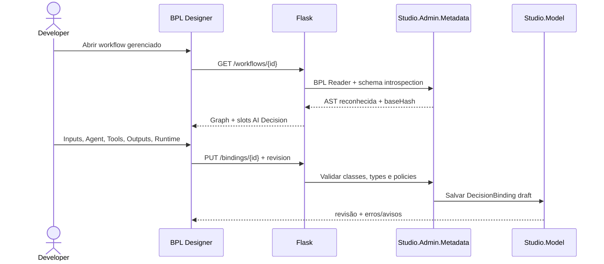
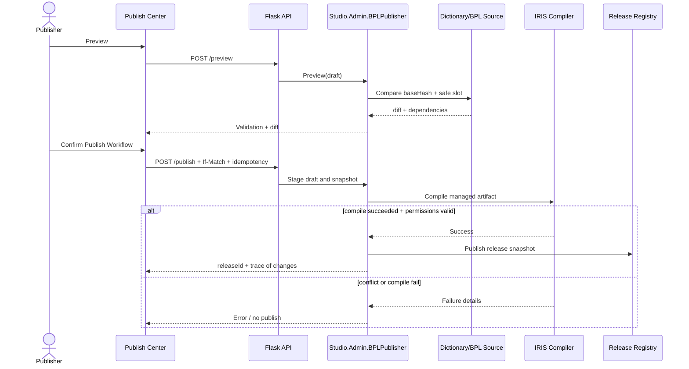
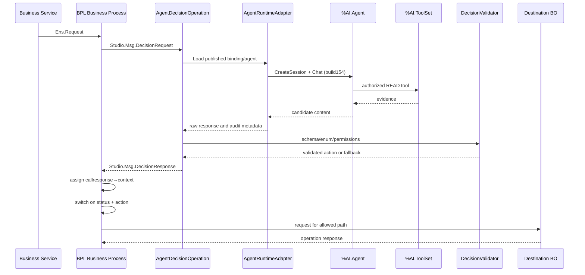

# SEQUÊNCIAS OPERACIONAIS — HTTP, PUBLISH E EXECUÇÃO

## A. Edição de AI Decision (sem efeito runtime)

## B. Publicação (não pode simular êxito)

## C. Produção real — evento a operação (requisito do concurso)

**Regras:** a decisão não chama diretamente o BO de destino; o switch BPL tem targets estáticos publicados; status inválido ou timeout percorre fallback. Session de AI Hub não equivale à Interop session.

## D. Falhas e classificação

- FALHA HTTP: Flask retorna erro sem afetar mensagens em fila da Production.
- FALHA SDK/Provider: Bridge transforma a falha em status tipado + fallback; se a falha for de infraestrutura, tratamento de exceção BPL permanece obrigatório.
- FALHA Tool não autorizada: tool não executa, evento `DENIED`, fallback.
- FALHA Output malformado: validação retorna `INVALID`, nunca executar ação extraída de texto.
- FALHA Publish: nenhuma afirmação de release publicada; guardar logs e estado anterior.
- RETRY/redelivery: usar idempotency/correlation conforme BO de destino; não assumir exactly-once.
