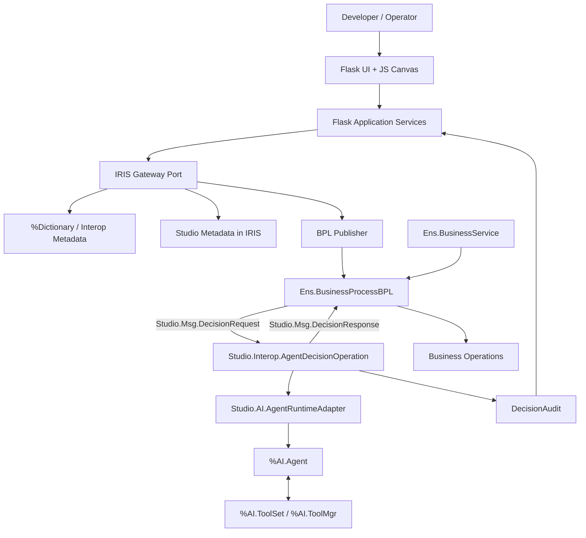

# AGENTIC BPL STUDIO — SPEC TÉCNICA DE IMPLEMENTAÇÃO

**DOCUMENTO:** SPEC-TECH-ABS-001  
**REV.:** 1.0 — 25/10/2026  
**REFERÊNCIA FUNCIONAL:** `SPEC/SPEC_FUNCIONAL_MVP.md` (SPEC-FUNC-ABS-001)  
**ESTADO:** ARQUITETURA PROPOSTA; AMBIENTE IRIS BUILD 154 NÃO INSPECIONADO; NENHUMA CLASSE NOVA COMPILADA.  
**LINGUAGEM:** Especificação operacional; SHALL/DEVE indica requisito vinculante; SHOULD/DEVERÁ preferencial indica opção; MAY/PODE indica extensão.  
**BUILD ALVO:** InterSystems IRIS AI Hub Community `2026.3.0AI.154.0`.

> **ORDEM CENTRAL:** o produto publica **workflows BPL da Interoperability com execução de `%AI.Agent` nativo**; NÃO publica chatbots independentes, NÃO cria linguagem de workflow paralela e NÃO altera código do Management Portal, kernel ou classes `%AI.*`/`Ens.*`.

## 0. BASE DE EVIDÊNCIAS E LIMITAÇÕES

| Código | Evidência | Interpretação |
|---|---|---|
| E-01 | BPL é editor e runtime nativo, possui `call`, `assign`, `switch`, variáveis e XData BPL | Fundamenta ponte via atividades documentadas; esquema exato requer validação |
| E-02 | `Ens.BusinessOperation` define handler com `(pReq As RequestClass, Output pResp As ResponseClass) As %Status` e `XData MessageMap` | Fundamenta assinatura do adaptador proposto |
| E-03 | IRIS suporta Python WSGI por aplicação web, servidor web/Web Gateway e callable | Fundamenta hospedagem Flask **condicionada** ao build |
| E-04 | SDK AI Hub documenta `%AI.Agent`, `%AI.Provider`, `%AI.ToolSet`, `%Init`, `CreateSession`, `Chat` em EAP | **Não prova** disponibilidade/assinatura idêntica no 154 |
| E-05 | Concurso solicita workflow IRIS Interoperability em que AI Hub toma decisão; build 154 | Impõe teste de execução nativa |
| E-06 | Sete agentes `.agent.md` anexos | São guias de engenharia, **NÃO sete agentes LLM necessários no runtime** |

**Referências oficiais:**
- BPL Editor: https://docs.intersystems.com/irislatest/csp/docbook/DocBook.UI.Page.cls?KEY=EBPL_editorintro
- BPL Introduction: https://docs.intersystems.com/irislatest/csp/docbook/DocBook.UI.Page.cls?KEY=EBPL_intro
- Business Operations: https://docs.intersystems.com/irislatest/csp/docbook/DocBook.UI.Page.cls?KEY=EGDV_busop
- WSGI: https://docs.intersystems.com/irislatest/csp/docbook/DocBook.UI.Page.cls?KEY=AWSGI
- AI Hub SDK: https://github.com/intersystems-community/ai-hub-eap/blob/master/ObjectScript_SDK_Guide.md
- Concurso: https://community.intersystems.com/post/intersystems-programming-contest-ai-agents-interoperability-workflows

## 1. SITUAÇÃO E MISSÃO

### 1.1 Situação

O editor BPL da InterSystems já oferece canvas, atividades, Inspector, variáveis `request/context/response`, gerenciamento de fluxo e compilação. A lacuna do produto é uma **forma visual de conectar Inputs do BPL ao agente AI Hub, conceder ToolSets autorizadas, validar Output estruturado e definir destinos BPL**.

### 1.2 Missão operacional

Fornecer quatro telas: (T-01) Workflow Explorer, (T-02) Agentic BPL Designer com cinco abas de Inspector, (T-03) Test & Trace, (T-04) Workflow Publisher. O comando **Publish Workflow** deve produzir uma revisão BPL nativa, suas configurações vinculadas e dependencies, com deploy controlado.

### 1.3 Regras de engajamento

1. O **BPL** detém fluxo, roteamento, espera, tratamento de erro, efeitos externos.
2. O **AI Hub** detém ciclo agente/modelo/ferramentas, retornando decisão, razões e evidências.
3. O **Bridge** materializa `Ens.Request`/`Ens.Response` e valida a resposta antes de devolver ao BPL.
4. O **Flask/WSGI** administra rascunhos, metadados, visualização, testes e publicação; **NUNCA** substitui `Ens.*` na execução de mensagens.
5. Toda saída de IA é **não confiável** até validar enum, schema e políticas; ToolSets não ganham permissão por prompt.
6. Publicação de uma revisão deve ser imutável e identificável; alterações no agente compartilhado não reconfiguram workflows já publicados.
7. Modificações só ocorrem em componentes explicitamente gerenciados pelo Studio. Processos desconhecidos ficam read-only.
8. Capacidades Vector Search e IntegratedML são opcionais, expostas como ToolSets instaladas quando existirem, sem usar nomes presumidos do AI Hub.

## 2. DECOMPOSIÇÃO C4 — CONTEXTO / CONTÊINERES / COMPONENTES



### 2.1 Control Plane (configuração)

- `backend/studio/api`: APIs HTTP e páginas, autenticação, validação de parâmetros HTTP; sem regras de workflow.
- `backend/studio/services`: serviços Python puros, DTOs e interface `IrisGateway`.
- `Studio.Admin.*`: única superfície administrativa ObjectScript autorizada para leitura de metadados e publicação.
- `Studio.Model.*`: definições versionadas de workflow, agente, binding, publicação e auditoria.
- `Studio.Admin.BPLPublisher`: staging, diff, validação e compile; alteração de classes IRIS **somente via comando autorizado**.

### 2.2 Execution Plane (Productions)

- `Studio.Msg.DecisionRequest` e `Studio.Msg.DecisionResponse`: mensagens persistíveis, tipos explícitos.
- `Studio.Interop.AgentDecisionOperation`: Business Host reutilizável para múltiplas atividades BPL.
- `Studio.AI.AgentRuntimeAdapter`: única classe dependente de detalhes do SDK AI Hub 154; centraliza criação `%AI.Agent`, ToolSets, Session e `Chat`.
- `Studio.AI.DecisionValidator`: valida saída estruturada, autorizada e bounded.
- `Studio.Model.ExecutionAudit`: correlação sem prometer visualização automática de tool calls internas.
- `Studio.Demo.*`: Production/BPL/BS/BO sintéticos, prova do concurso; sem dependência de domínio de saúde.

### 2.3 Fluxos de chamada

**Leitura:** `Browser → Flask /api → IrisGateway → Studio.Admin.Metadata → %Dictionary / Ens.* → JSON autorizado`.

**Edição:** `Browser → Flask → WorkflowService.validate → Studio.Model.Draft (versionado)`. Não modifica classe BPL compilada.

**Publicação:** `Browser → preview diff → confirmação explícita → lock/etag → Stage BPL → Compile → verificação → Promotion controlada → Release imutável`. Falha não declara sucesso; preservar fonte anterior.

**Operação:** `Business Service → BPL.call → DecisionRequest → AgentDecisionOperation → AgentRuntimeAdapter → %AI.Agent + tools → DecisionValidator → DecisionResponse → BPL.assign → BPL.switch → BO final`.

### 2.4 Política de versionamento

- `WorkflowRevision` referencia `agentDefinitionId@revision`, `decisionBindingId@revision`, classe BPL/namespace e snapshot/hash dos artefatos.
- O executor consulta **somente dados publicados** (release ID), jamais draft.
- Em mensagem em voo, seu `releaseId` não deve mudar. Se a implementação usar configuração publicada mutável, corrigir antes da demonstração.
- Autorização de publicação separada de edição; sincronização otimista via `ETag`/`baseHash`.

## 3. TELAS — CONTRATO DE INTERAÇÃO

### T-01 Workflow Explorer

**Entrada:** usuário autenticado, namespace selecionada, filtros.  
**Fonte:** `GET /api/v1/capabilities`, `GET /api/v1/productions`, `GET /api/v1/workflows`.  
**Saída:** lista de BPLs com `managed`, `readOnlyReason`, `production`, `className`, `revision`, `decisionCount`.

| Ação | Endpoint | Regras | Resultado |
|---|---|---|---|
| Carregar ambiente | GET `/capabilities` | usuário/namespace autorizados | compatibilidade build, WSGI, AI Hub e tooling |
| Escolher Production | GET `/productions` | somente metadados visíveis | hosts exibidos |
| Abrir workflow | GET `/workflows/{id}` | read-only para BPL desconhecido | AST/representação reconhecida |
| Novo workflow | POST `/workflows` | template whitelisted | draft gerenciado |

**NÃO** prometer importação bidirecional de qualquer BPL. A primeira release suporta template e marcador de bloco gerenciado.

### T-02 Agentic BPL Designer

**Entrada:** `workflowId`, `draftRevision`, seleção do nó, metadados tipados.  
**Saída:** `DecisionBinding` versionado e validação local/servidor.

- **Canvas:** mostrar sequência BPL, nós conhecidos e nós desconhecidos read-only; proibir alterações fora de trecho gerenciado.
- **Inspector/Input:** selecionar fonte `{request,context,constant}`, propriedade/tipo, conversão básica, required, preview redigido. Validar `path`, propriedade e tipo via Dictionary.
- **Inspector/Agent:** `agentDefinitionId`, provider configurado/permitido, modelo, prompt, sessão por mensagem, limites; referenciar `%AI.Agent` real por adapter.
- **Inspector/Tools:** ToolSets realmente instaladas, `READ/WRITE`, assinatura, política declarada, ativo/inativo. READ default. Ausência de ToolSet bloqueia.
- **Inspector/Outputs:** schema de `DecisionResponse`, enum permitido, mapeamento `callresponse → context`, roteamento BPL via switch; obrigar fallback para `INVALID/ERROR/TIMEOUT`.
- **Inspector/Runtime:** limites de tempo, tool calls, sessões, retries (apenas idempotentes), política de falha e auditoria.

**Estados:** `INCOMPLETE → VALID → STAGED → PUBLISHED`; editar após publicado cria novo draft. `VALID` depende de resolução de referências ao namespace instalado.

**Modelo de componente composto:** `AI Decision` = BPL `call` para `AgentDecisionOperation`, `assign` no retorno, `switch` usando somente enum validado. A aparência específica do bloco existe no Studio, não necessariamente no editor oficial.

### T-03 Test & Trace

**Entrada:** Request de teste tipado, release de sandbox; opcional mock explicitamente marcado.  
**Saída:** IDs `messageId`, `sessionId` (Interop), `agentSessionId` (AI Hub), `decisionExecutionId`, tool audit, decisão validada, BO final.

- POST `/test-runs` com `mode=live` **somente** no Service de teste allowlisted; execução real deve acionar produção BPL.
- `mode=simulation` é separado, visualmente sinalizado, não substitui Gate-04.
- GET `/runs/{id}` consulta observabilidade correlacionada; nunca inventa tool calls não capturadas.
- Falha API/timeout deve informar `ERROR`, rotas e evidências de invocação; evitar segredos em payloads/logs.

### T-04 Workflow Publisher

**Entrada:** draft VALID, baseHash, identidade com papel PUBLISHER.  
**Saída:** release id imutável, relatório de validação, diff de BPL, resultados de compile e instalações declaradas.

- POST `/workflows/{id}/validate` valida estrutura e dependências, sem mutação runtime.
- POST `/workflows/{id}/preview` gera diff e dependências, sem publicar.
- POST `/workflows/{id}/publish` exige `revision`, `baseHash`, confirmação e idempotency key; backend recusa conflitos.
- GET `/workflows/{id}/releases` exibe histórico; rollback mediante publicação de revisão anterior sob controle, não promete desexecutar efeitos externos.
- **Proibição:** `Publish Agent` não existe; publicar **sempre o workflow** com seu binding de agente.

## 4. MODELO DE DADOS E CONTRATOS

### 4.1 Entidades persistentes (`Studio.Model.*`; nomes PROPOSTOS)

| Classe | Principais propriedades | Identidade/estado |
|---|---|---|
| `WorkflowDraft` | `WorkflowId`, `ProductionName`, `BPLClass`, `BaseHash`, `GraphJson`, `Revision`, `Status` | draft por workflow |
| `AgentDefinition` | `AgentId`, `Revision`, `ProviderRef`, `ModelName`, `Prompt`, `ToolSetRefsJson`, `LimitsJson`, `Status` | versionado; sem credenciais |
| `DecisionBinding` | `BindingId`, `WorkflowId`, `ActivityId`, `AgentId`, `AgentRevision`, `InputsJson`, `OutputsJson`, `RoutesJson`, `FailurePolicyJson` | por atividade |
| `WorkflowRelease` | `ReleaseId`, `WorkflowId`, `Revision`, `SourceHash`, `CompiledBPLClass`, `ManifestJson`, `PublishedAt`, `PublishedBy`, `Status` | imutável |
| `ExecutionAudit` | `DecisionExecutionId`, `ReleaseId`, `BindingId`, `MessageId`, `InteropSessionId`, `AgentSessionId`, `Status`, `Action`, `ToolAuditJson`, `DurationMs`, `CreatedAt` | por chamada |

**Persistência:** classes `%Persistent` (a definir Storage depois), chaves únicas de revisões e bindings; segredos no mecanismo seguro suportado pelo build, NUNCA persistidos em prompt/drafts.

### 4.2 Request operacional — contrato proposto

```json
{
  "schemaVersion": "1",
  "releaseId": "release-001",
  "bindingId": "event-routing:ai-1",
  "correlationId": "msg-101",
  "input": {"eventId":"E-101", "description":"..."}
}
```

### 4.3 Response operacional — contrato proposto

```json
{
  "schemaVersion": "1",
  "status": "SUCCESS",
  "action": "REVIEW",
  "reason": "Evidence incomplete",
  "evidenceRefs": ["rule-1"],
  "decisionExecutionId": "run-101",
  "errorCode": ""
}
```

- `status ∈ {SUCCESS, INVALID, ERROR, TIMEOUT, DENIED}` é **do executor**, não enunciado livre do LLM.
- `action` deve pertencer às ações declaradas pelo `DecisionBinding`; quando `status != SUCCESS`, usar rota de fallback determinística.
- Não declarar `confidence` numérica como probabilidade calibrada; não tomar ação crítica com base em confiança gerada livremente pelo LLM.
- `evidenceRefs` referenciam itens auditáveis quando disponíveis; strings externas não implicam veracidade.
- Limitar tamanho e quantidade de evidências, tokens/iterações, tool calls, latency; classificar erros transitórios vs permanentes.

### 4.4 Contrato de binding (exemplo)

```json
{
  "bindingId":"event-routing:ai-1",
  "agentRef":{"id":"event-analyzer","revision":1},
  "inputs":[
    {"source":"request.EventId","target":"eventId","required":true},
    {"source":"request.Description","target":"description","required":true}
  ],
  "outputs":{"action":"context.AIDecision","reason":"context.AIReason"},
  "routes":{"PROCESS":"ProcessOperation","REVIEW":"ReviewOperation","REJECT":"RejectOperation"},
  "fallback":{"action":"REVIEW","target":"ReviewOperation"},
  "timeouts":{"agentMs":30000}
}
```

`routes` são destinos de BO conhecidos; não incluir código ObjectScript livre no manifest. A validação deve confirmar a existência do Business Host de destino.

## 5. MAPA DE REPOSITÓRIO E RESPONSABILIDADES

A árvore de diretórios completa está em `SPEC/REPO_MAP.md`. Convenção: `.cls` é fonte humana, `.int`/artefatos compilados não são versionados; scripts de bootstrap separados de código imutável; outputs gerados dentro do IRIS não alteram fonte Git automaticamente.

### 5.1 Cadeia de dependência

```text
UI Flask / JS (HTTP)
  → Python services / IrisGateway (interface)
    → Studio.Admin.* (ObjectScript, autorização/metadata/publicação)
      → Studio.Model.* (%Persistent), %Dictionary, Ens.*
  → [workflow publicado] Ens.BusinessProcessBPL
    → Studio.Interop.AgentDecisionOperation
      → Studio.AI.AgentRuntimeAdapter [isolamento do SDK 154]
      → Studio.AI.DecisionValidator
      → Studio.Model.ExecutionAudit
    → BPL switch → Business Operation de destino
```

### 5.2 Dependências obrigatórias vs opcionais

**Core obrigatório:** BPL/Interop, AI Hub Agent + ToolSet, Dictionary, Flask WSGI ou Flask externo, armazenamento IRIS, Publisher mínimo.

**Extensão opcional:** Vector Search e IntegratedML; expostos ao agente por classes ToolSet explícitas, se capacidades/datasets existirem. NÃO construir pipelines de treinamento ou RAG só para declarar uso das tecnologias.

## 6. CONTRATOS DE MÉTODOS — LIMITES DE VERSÃO

**Fonte de verdade:** `SPEC/OBJECTSCRIPT_INTERFACES.md` detalha todas as assinaturas propostas; `contracts/openapi.yaml` detalha endpoints Flask. Apresentação abreviada:

```objectscript
// CÓDIGO DE INTERFACE PROPOSTO — NÃO COMPILADO; nomes Studio.* são nossos
Class Studio.Interop.AgentDecisionOperation Extends Ens.BusinessOperation
{
  Method HandleDecision(pRequest As Studio.Msg.DecisionRequest,
                        Output pResponse As Studio.Msg.DecisionResponse) As %Status
  XData MessageMap { /* MapItem MessageType=Studio.Msg.DecisionRequest → HandleDecision */ }
}

Class Studio.AI.AgentRuntimeAdapter Extends %RegisteredObject
{
  ClassMethod Invoke(pAgent As Studio.Model.AgentDefinition,
                     pInput As %DynamicObject,
                     pExecutionId As %String,
                     Output pRawResponse As %String,
                     Output pSessionId As %String) As %Status
}

Class Studio.AI.DecisionValidator Extends %RegisteredObject
{
  ClassMethod Validate(pBinding As Studio.Model.DecisionBinding,
                       pRawResponse As %String,
                       Output pResult As %DynamicObject) As %Status
}
```

`HandleDecision` coincide com a **forma documentada** de handler BO, porém não foi compilado neste ambiente. Assinaturas `%AI.*` **não estão validadas no 154**; ficam encapsuladas em `AgentRuntimeAdapter`.

## 7. PRINCIPAIS DECISÕES DE DESIGN (ADRs)

### ADR-001 — BPL é motor único
**Decisão:** Control Plane Flask jamais executará workflow operacional. **Motivo:** aderência ao concurso, uso de Visual Trace, semântica real de mensagens, fila e timeout.

### ADR-002 — `AI Decision` é macrocomponente visual
**Decisão:** traduzir para `call + assign + switch`, ou template compilável equivalente. **Motivo:** não alterar editor/compiler; legibilidade no Management Portal oficial.

### ADR-003 — Business Operation genérica
**Decisão:** `AgentDecisionOperation` com handler de `Ens.Request`. **Motivo:** isolamento das dependências EAP e reutilização; retornar resposta tipada ao BPL. **Trade-off:** tempo bloqueado em espera de LLM e dimensionamento do pool; testar síncrono primeiro, otimizar depois.

### ADR-004 — Configuração de Agent x Binding
**Decisão:** AgentDefinition versionado, DecisionBinding independente por ponto do BPL. **Motivo:** reuso entre múltiplos workflows sem mudança silenciosa.

### ADR-005 — Publicação restrita
**Decisão:** primeiro templates e BPL gerenciado com hash, staging e diff. **Motivo:** parser/generator BPL universal é caro e arriscado.

### ADR-006 — Flask dentro do IRIS apenas sob teste
**Decisão:** preferir Flask/EmbeddedPython/WSGI em instância com Web Gateway; alternativa externa preserva mesmos contratos. **Motivo:** 154 pode ter diferenças de empacotamento de servidor web.

### ADR-007 — Ferramentas somente leitura no MVP
**Decisão:** ToolSets READ auditáveis; operação de escrita só via BO BPL após validação. **Motivo:** impedir mutação oportunista induzida por prompt injection.

### ADR-008 — Publicação de workflow como unidade
**Decisão:** release contém snapshot de AgentDefinition, Binding, BPL e dependências. **Motivo:** o artefato de valor não é agente avulso.

## 8. REGRAS DE SEGURANÇA E CONFIABILIDADE

- **S-01:** AuthN/AuthZ por namespace e perfil; leitura e publicação com papéis distintos.
- **S-02:** Proteção CSRF para formulários com sessão, tokens/titulares seguros para API, cookies `Secure/HttpOnly/SameSite`; nega CORS amplo.
- **S-03:** Rate limiting, limites de payload, validação de path/className/ids, antiforgery em publish.
- **S-04:** Guardas server-side antes de compile ou configuração; nada de SQL dinâmico ou ObjectScript interpolado do LLM.
- **S-05:** Segredos no Wallet/Config Store se presentes no build, fallback seguro por ambiente para dev; nunca em fonte/log/UI.
- **S-06:** `ToolSetRefs` allowlist, least privilege, caller identity, escopo por namespace/Production.
- **S-07:** Output LLM se torna dados, nunca parâmetro de `target` ou `className` livre; rota resolvida por enum configurado.
- **S-08:** Timeouts BPL/BO/Provider coordenados; retry idempotente somente se comprovado; nunca alegar exactly-once.
- **S-09:** Auditoria sem dados protegidos indevidos; session AI Hub distinta de session Interop; mensagens em voo pinadas à release.
- **S-10:** Publicação com lock/ETag; backup da versão anterior; rollback de artefatos não reverte efeitos externos.

## 9. ESTRATÉGIA DE PUBLICAÇÃO E BPL ROUND-TRIP

**MVP compatível**:
1. Criar classe BPL com template oficial conhecido e um slot gerenciado para `AI Decision`.
2. Ler fonte BPL/XData, metadados de classe e `baseHash` via API de introspecção.
3. Criar `DecisionBinding`, gerar manifest, usar estrutura documentada `call → assign → switch` em slot conhecido.
4. Validar names, classes, tipagem, ToolSets, Provider, BO destinations, fallback.
5. Gerar diff e salvar draft; não alterar runtime.
6. Em Publish: revalidar fonte, detectar divergência; guardar snapshot; stage e compilar em ambiente de demonstração; ativar via configuração autorizada.
7. Registrar release imutável e correlacioná-la com as execuções.

**BPL legado/arbitrário**: listar, visualizar e navegar em modo somente leitura. Não normalizar/reformatar o XML BPL que contenha atividades desconhecidas. Não sobrescrever BPL modificado externamente.

**Futuro:** importação e round-trip suportado por subconjuntos incrementais do schema BPL com testes de equivalência semântica.

## 10. FLASK / WSGI / DEPLOY

- Factory `create_app(config=None) -> Flask`; objeto `application = create_app()` em `wsgi.py` (callable PEP 3333). `Web Gateway → IRIS Web Application (WSGI) → Python code`.
- Sem `app.run()` em produção dentro de WSGI. Desenvolvimento local com Flask CLI serve **somente** à camada administrativa/contratos, não à execução IRIS.
- `IrisGateway` define interface para `list_productions`, `get_bpl`, `save_draft`, `validate`, `preview_publish`, `publish`, `get_trace`. A implementação `EmbeddedIrisGateway` faz chamada `iris.cls("Studio.Admin...")` em namespace autorizada; implementação externa futura usa SDK/API IRIS.
- HTML: Flask/Jinja templates + JavaScript de grafo (biblioteca escolhida por licença, manutenção e segurança). O diagrama parcial deve suportar nós BPL somente leitura e nós AI Decision gerenciados.
- No build 154 sem Web Gateway configurado, opção separada `Flask externo → API segura IRIS`; **não** pressupor que porta 52773 exista.
- Imagem EAP obtida e carregada localmente pelo avaliador; Docker Compose usa tag local. Não publicar imagem ou derivados da EAP em registros públicos.
- Configurar WSGI App Directory, Application Name, Callable Name e auth no IRIS depois de validar a versão. Preparar scripts idempotentes sem hardcode de `_SYSTEM`/senhas.

## 11. TESTES POR CAMADA

| Nível | Casos prioritários | Gate |
|---|---|---|
| Contract Python | Input mapping, enum action, schemas, 400/403/409/501; ausência de segredo | G2 |
| Agent Runtime | Agent real init + sessão + ToolSet + decisão; indisponibilidade | G1 |
| Interop | BS → BPL → AgentDecisionOperation → BO, timeout, repetição | G1/G4 |
| Dictionary | XData BPL, parâmetros, classes, métodos; read-only | G0/G2 |
| Publisher | ETag/baseHash, diff, rejeitar BPL desconhecido, compile fail, rollback | G3 |
| Flask/WSGI | WSGI callable, prefixo URL, autenticação, limite de upload e gateway | G0/G3 |
| Observability | Mensagem x agent session x tools x destino, dados sensíveis redigidos | G4 |
| Optional ToolSets | Vector retrieval read-only e IntegratedML prediction em fluxo existente | Pós-MVP |

**Testes determinísticos com mocks:** permitidos para a camada Python, sempre com marcação. **Demonstração do concurso:** agente real em build 154, ToolSet real e BPL real.

## 12. COMANDO / COORDENAÇÃO DOS SETE ESPECIALISTAS

| Perfil `.agent.md` | Liderança | Artefatos alvo | Aceite exigido |
|---|---|---|---|
| `docker.iris` | Infra, build, bootstrap, Compose, IPM | `deploy/`, docs, CI | `docker compose up` documentado; imagem EAP não distribuída |
| `IA_HUB` | `%AI.Agent`, ToolSet, Provider, Session, Policy | `src/iris/Studio/AI/` | chamada real no build 154; retorno verificável |
| `iEmbeddedPython` | Flask/Embedded Python/WSGI | `backend/` | WSGI callable, auth e acesso IRIS corretos |
| `iInteroperability` | Business Host, mensagens, BPL e Trace | `src/iris/Studio/{Interop,Msg,Demo}/` | BS→BPL→BO com decisão e fallback |
| `iris.Dictionary` | Descoberta de metadata e parser seguro | `src/iris/Studio/Admin/Metadata.cls`, `BPLReader.cls` | fonte vs compilado separados; read-only em desconhecidos |
| `iris.VectorSearch` | Extensões ToolSet READ por retrieval | futuro `Studio/Tools/VectorRead.cls` | não obrigatório ao MVP, sem side effects |
| `iris.IntegratedML-AutoML` | Extensões ToolSet READ de predição | futuro `Studio/Tools/Prediction.cls` | não obrigatório ao MVP, modelo existente |

**Ordem de revisão cruzada:** Interop + AI Hub aprovam contrato Request/Response → Dictionary aprova introspecção → Embedded Python aprova API WSGI → Docker aprova topologia → Vector/ML avaliam extensibilidade opcional.

## 13. GATES OPERACIONAIS — GO/NO-GO

**G0 CAPABILITIES:** verificar `%AI.*`, Python runtime, Web Gateway, ToolSet XML e classes Interop **no build 154 real**. Se falha WSGI: decidir gateway externo sem afetar runtime.

**G1 SMOKE CORE:** implementar mensagem real, BO bridge, Agent + ToolSet, retorno tipado e `BPL.switch`. Se falhar: NÃO desenvolver canvas.

**G2 CONTRACT:** agendamento de configuração, DTO, Input/Output mapping, validação de rotas e sessão.

**G3 EDITOR + PUBLISH:** 4 telas, Inspector 5 abas, managed BPL, diff, compile, revisão imutável.

**G4 DEMO:** dois eventos, decisões distintas, uma ToolSet real, Visual Trace correlacionado, fallback em exceção, README reproduzível.

**NO-GO absoluto:** chamar agente em Flask no lugar do IRIS; executar decisão apenas como simulação; permitir target arbitrário definido pelo LLM; compilar sobre classe não gerenciada; depender de APIs de build 162 não presentes no 154; distribuir imagem EAP.

## 14. RISCOS E CONTRAMEDIDAS

| Risco | Gravidade | Contramedida |
|---|---|---|
| 154 difere do SDK master | Alta | adaptar somente `AgentRuntimeAdapter` após introspecção |
| Falta servidor HTTP na EAP | Alta | gateway/Web Gateway explícito, opção Flask separado |
| BPL XML round-trip | Crítica | templates e slots gerenciados; legado read-only |
| Prompt injection pela Tool | Alta | resposta como dados não confiáveis, tools allowlist |
| Efeitos duplicados por retry | Alta | chaves idempotentes, controle no BO destino |
| Job pool saturado pelo LLM | Alta | limites e métricas, timeout, teste de concorrência; async futuro |
| Versionamento inconsistente | Alta | binding/release imutáveis, ETag e checks antes de publish |
| Ausência de trace de tools | Média | instrumentar logs próprios correlacionáveis |
| Prazo do concurso | Alta | priorizar G1 antes da UI; mínimo de quatro telas |

## 15. MATRIZ DE RASTREABILIDADE

| Requisito da SPEC funcional | API Flask | Classe IRIS | Teste | Gate |
|---|---|---|---|---|
| EX-01..06 Explorer | GET `/productions`, `/workflows` | `Studio.Admin.Metadata`, `BPLReader` | `test_explorer.py` | G2 |
| IN-01..05 Input | PUT `/bindings/{id}` | `Studio.Admin.Metadata`, `Studio.Model.DecisionBinding` | `test_mapping.py` | G2 |
| AG-01..05 Agent | PUT `/agents/{id}` | `Studio.Model.AgentDefinition`, `AgentRuntimeAdapter` | `test_agents.py` | G1/G2 |
| TL-01..04 Tools | GET `/toolsets`; PUT agent | `Studio.Admin.Metadata`, `%AI.ToolSet` | `test_permissions.py` | G1/G2 |
| OUT-01..07 Output | validate/publish | `DecisionValidator`, `BPLPublisher` | `test_decision_contract.py` | G2/G3 |
| Runtime error | Test & Trace | `AgentDecisionOperation` | `test_timeout_fallback.cls` | G1/G4 |
| TS-01..06 | `/test-runs`, `/runs/{id}` | `Studio.Demo.TestService`, `ExecutionAudit` | `test_demo_live.cls` | G4 |
| PB-01..07 | `/preview`, `/publish` | `Studio.Admin.BPLPublisher`, `WorkflowRelease` | `test_publisher.py` | G3 |
| Reutilização AgentBinding | `/agents`, `/bindings` | `AgentDefinition`, `DecisionBinding` | `test_agent_reuse.cls` | G4 |

**NOTA FINAL:** Esta SPEC é blueprint detalhado, não executável por si só. A camada Flask incluída no pacote é um scaffold de contrato/rotas, não prova de comunicação real com IRIS. Classes e métodos ObjectScript são **assinaturas propostas**, que precisam ser implementadas e compiladas no build 154.
