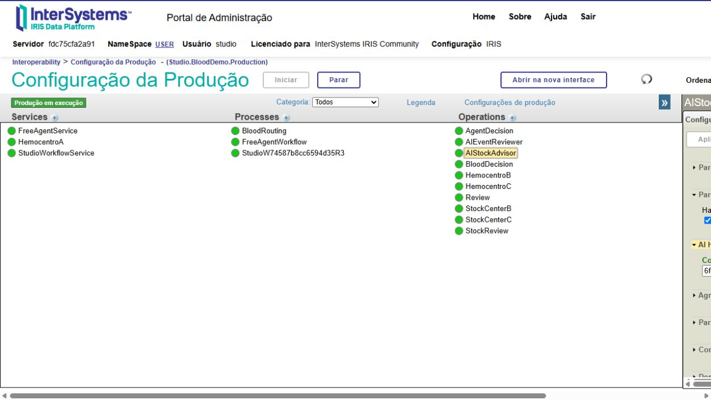
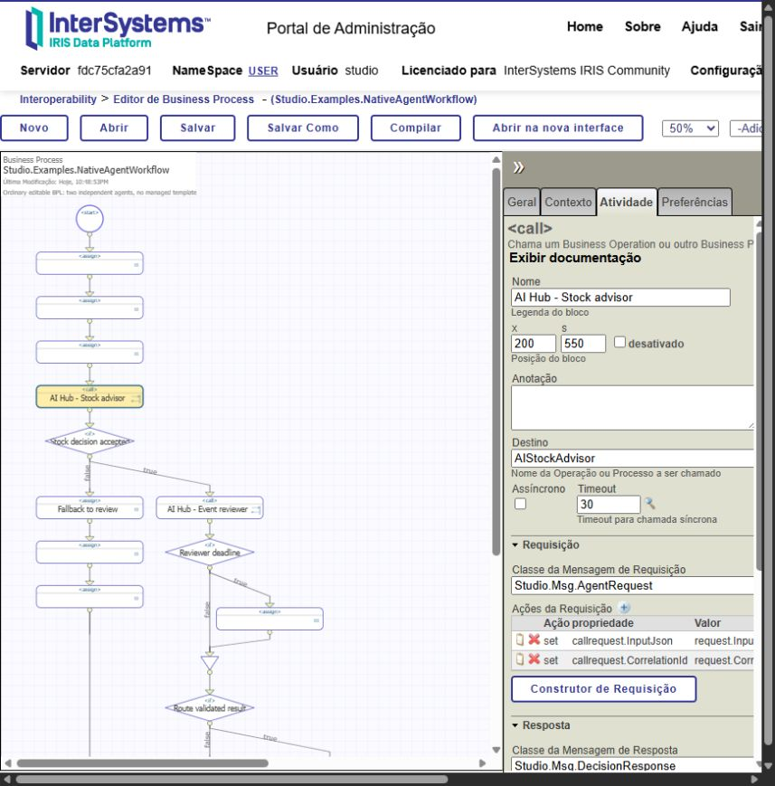
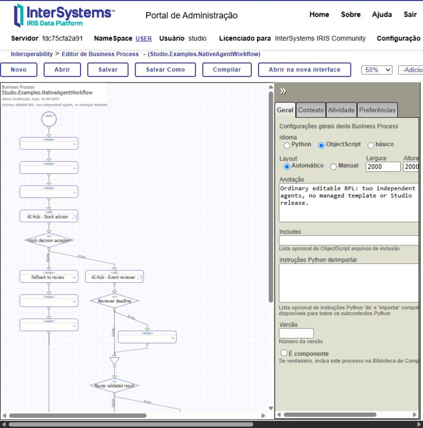
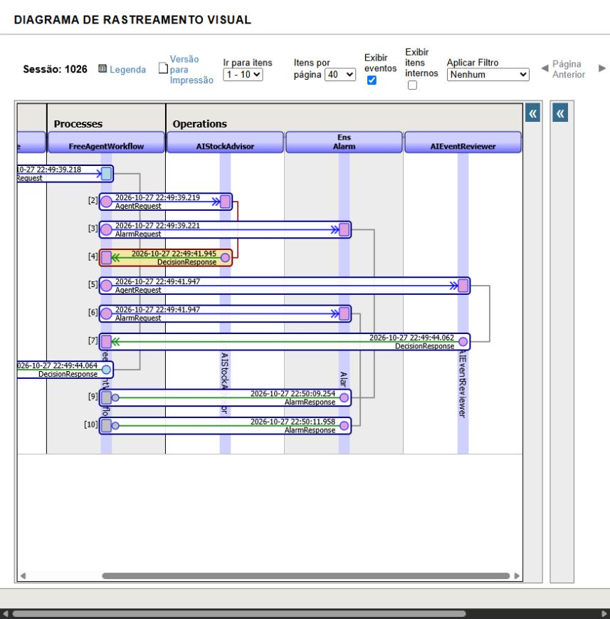
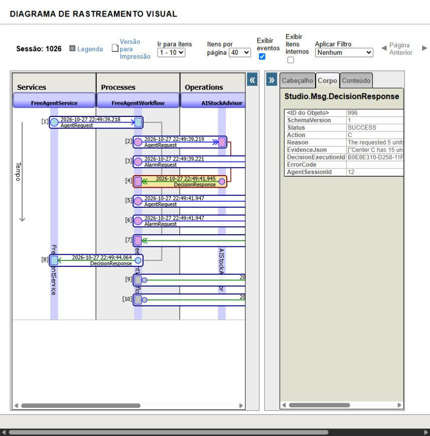

# Compose AI Hub agents in native IRIS BPL

[Português](NATIVE_BPL_PT_BR.md) · [README](../README.md)

An agent can be published as a standard Business Operation without a managed workflow or release. The native BPL editor owns the orchestration: insert Calls in valid sequences, branches or loops, map messages and route the validated result. Studio does not patch InterSystems portal classes.

## 1. Create and publish a component

1. Open **Workflow Explorer** and select your installed Production in `USER`.
2. Under **Create an AI Hub component**, select an existing agent revision or expand **Create or version an agent independently of a workflow**.
3. Set an agent ID, base revision `0` for a new agent, configured provider/model, instructions and authorized READ ToolSets. Click **Save agent revision**.
4. Choose a new Operation name, allowed actions, fallback and server validation policy. Click **Publish AI Hub Operation**.
5. Record the returned component ID and class. Publication pins an agent revision and adds a new Operation; it refuses an existing host name. To deploy an updated revision, publish a new host and deliberately update the caller.

For Getting Started, use the stock agent created in the [blood-center walkthrough](BLOOD_MVP.md): name `AIStockAdvisor`, actions `B,C,REVIEW`, fallback `REVIEW`, policy `blood-stock`. This policy requires `Studio.Tools.BloodStockTools` and validates observed inventory. For a domain-neutral second agent, publish `event-review` as `AIEventReviewer`, actions `ACCEPT,REVIEW`, fallback `REVIEW`, policy `schema`.

The generated Operation inherits `Studio.Interop.PortableAgentOperation`. In the native Production page, select its name and expand **AI Hub** to inspect `ComponentId`. Keep this binding unchanged: it identifies the pinned agent configuration and is checked against the Production and host at runtime.



## 2. Add a Call in your native BPL

Agent instructions must request one JSON object with `action` and optional `reason`/`evidenceRefs`; unknown fields are rejected. For example: “Call ReadEvent using the supplied eventId. Return ACCEPT only when eligible is true; otherwise REVIEW. Return JSON only, without Markdown or additional fields.” A valid candidate is:

```json
{"action":"ACCEPT","reason":"Event is eligible","evidenceRefs":["event:E-OK"]}
```

Open the native BPL editor, select a process you can edit, then insert **Call** where the decision belongs. Editing requires `%Ens_Code:RW`; the local installer assigns the dedicated `StudioBPLEditor` role to the project account. Re-login after a role change.

| Call setting | Value / mapping |
|---|---|
| Target | Published Operation name, e.g. `AIStockAdvisor` |
| Request class | `Studio.Msg.AgentRequest` |
| `callrequest.InputJson` | JSON object built from your input; stock example: `{"group":"A+","units":5}` |
| `callrequest.CorrelationId` | Your workflow correlation identifier |
| Response class | `Studio.Msg.DecisionResponse` |
| Response mappings | Copy `Action`, `Status`, `DecisionExecutionId`, `AgentSessionId` into context |
| Timeout and failure branch | Set explicitly; handle `synctimedout` and non-success status |

Initialize required response properties before BPL suspension. Route only validated responses. The Operation returns a decision; it does not perform the business dispatch. Your BPL controls subsequent Calls, branches and fallback. A BPL timeout does not cancel a provider request already running.



## 3. Open the supplied free-composition example

Open `Studio.Examples.NativeAgentWorkflow` in the native editor. It calls two independent Operations, without a Studio managed release. The stock agent reads synthetic inventory; the event agent reviews the independent synthetic event `E-OK`. The latter demonstrates another decision point; it is not a second stock audit. The final BPL requires both successful execution and event action `ACCEPT` before returning the stock recommendation.



After publishing the two Operations, add these hosts to the same Production in native configuration:

| Host | Class |
|---|---|
| `FreeAgentWorkflow` | `Studio.Examples.NativeAgentWorkflow` |
| `FreeAgentService` | `Studio.Examples.NativeAgentService` |

Enable both. The Service target defaults to `FreeAgentWorkflow`. Source bootstrap reload can remove these manually added example hosts; add them again afterwards. Published portable Operations are restored by `Studio.Admin.Workspace.ReconcileDeployments()`.

For the existing local Getting Started setup, `scripts/publish-native-example.py` publishes the two Operations using the saved stock agent in `validation/blood-live.json`. Run it once after that walkthrough; existing host names are deliberately rejected. It publishes configuration only. The explicit native test below invokes the configured provider and may incur charges:

```objectscript
// Run in USER with the example Production active and both Operations configured.
Do $SYSTEM.OBJ.Load("/opt/studio/tests/PortableAgentTest.cls","ck-d")
Set sc=##class(Studio.Tests.PortableAgentTest).Run()
Do $SYSTEM.Status.DisplayError(sc)
```

## 4. Inspect the real execution

In Production configuration, select the Operation → **Messages** → click its message header. Native **Visual Trace** shows the BPL requests and responses. Select **Body** to inspect `Status`, `Action`, `DecisionExecutionId` and `AgentSessionId`. Native message bodies retain their payload under IRIS permissions; Studio's audit export redacts the reasoning text.





These screenshots show recorded session **1026** ([receipt](../validation/native-free-agents-1026.json)). The final workflow, including the explicit event `ACCEPT` guard, passed in session **1039**, AI Hub sessions **14/15**: stock `C`, event `ACCEPT`, final `SUCCESS/C` ([latest receipt](../validation/native-free-agents.json)). Tool observations include `ReadStock` and `ReadEvent`. Earlier invalid model responses exercised fallback; one passing run does not guarantee deterministic model output.

## Boundaries

The MVP control plane targets `USER`, installed Productions and allowlisted READ ToolSets on AI Hub build 154. Native BPL composition is independent of managed templates; Studio's managed Designer still edits only recognized template slots. New domain tools and policy need developer implementation. The stock example recommends redistribution using synthetic data; no physical stock transfer or external hospital delivery is performed.
