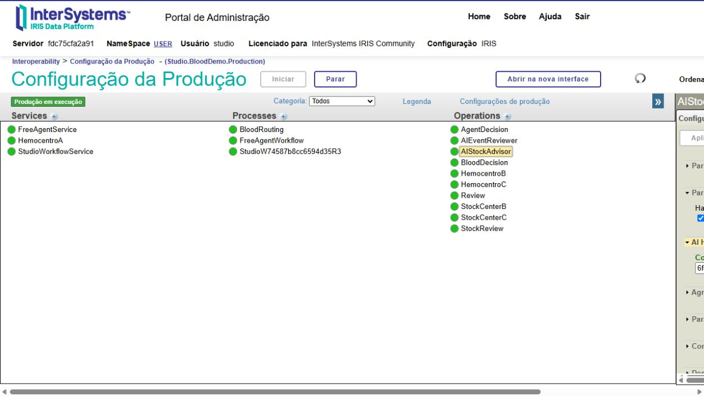
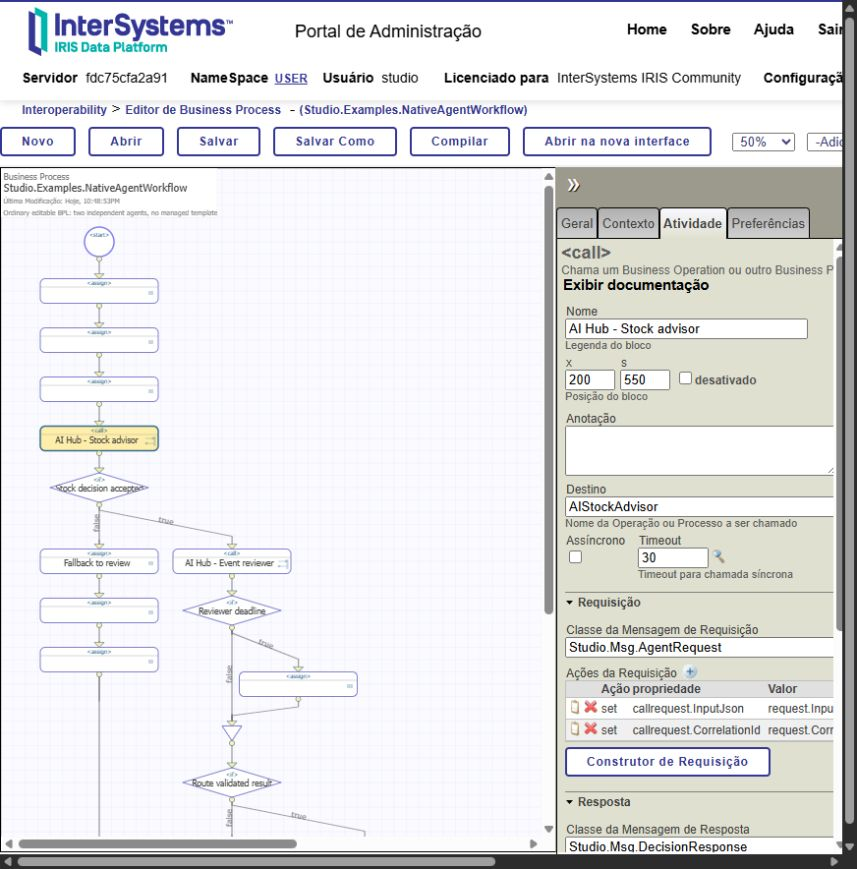
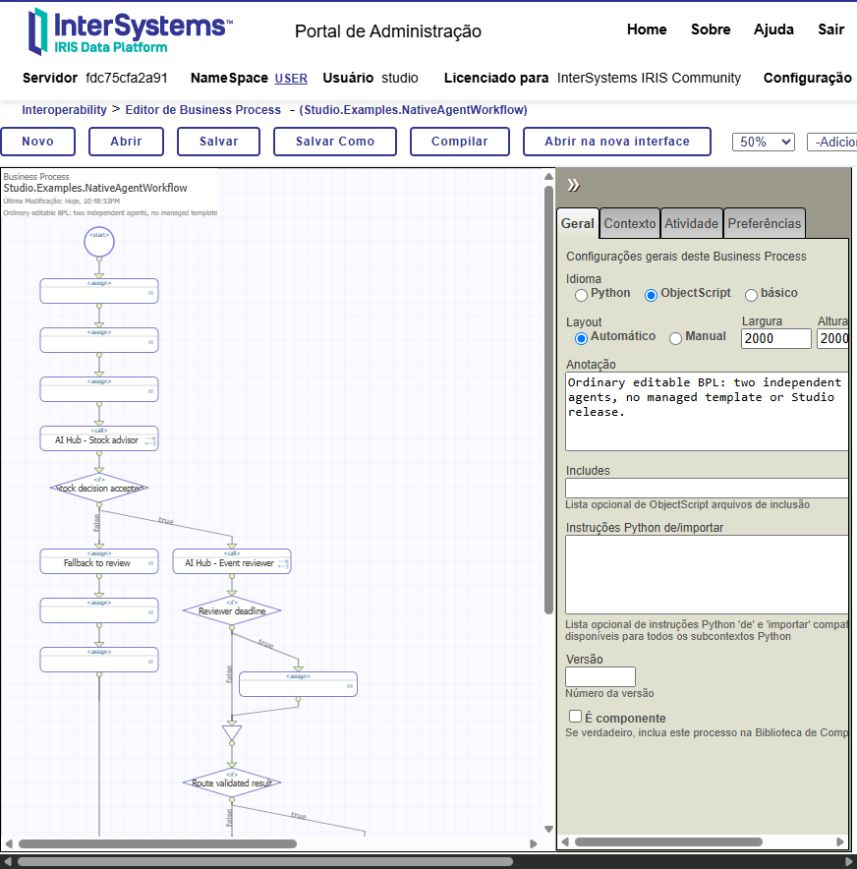
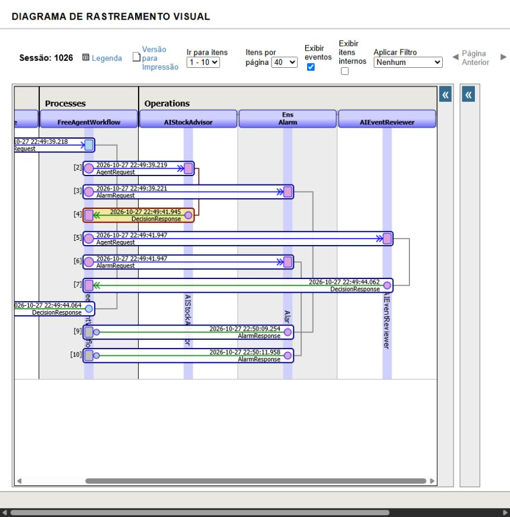
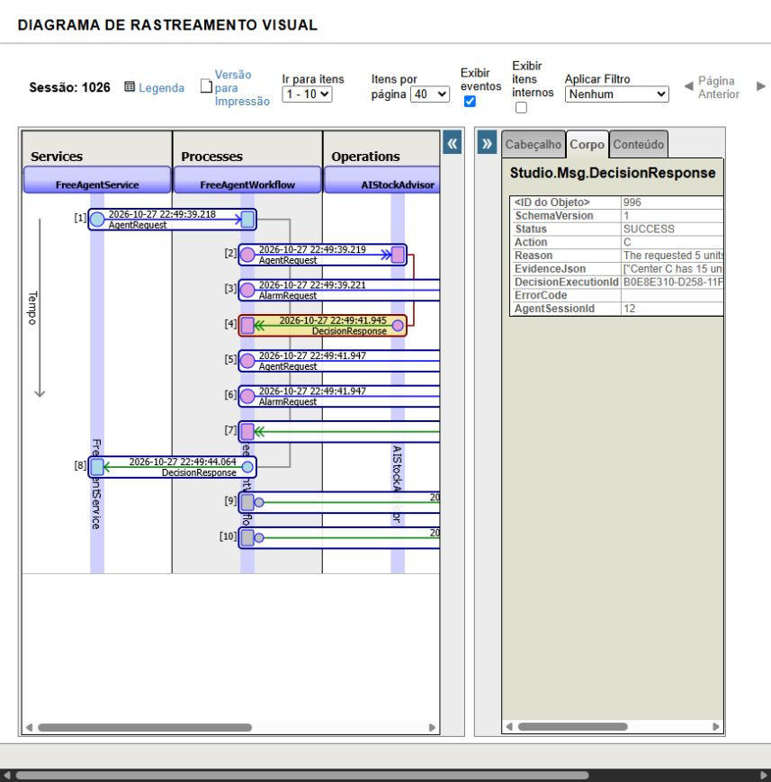

# Compor agentes AI Hub no BPL nativo do IRIS

[English](NATIVE_BPL.md) · [README](../README_PT_BR.md)

Publique o agente como uma Business Operation comum, sem template ou release gerenciada. No editor nativo, coloque Calls em sequências, condições e loops válidos; mapeie mensagens e encaminhe o resultado validado. O Studio não modifica classes internas do Portal InterSystems.

## 1. Criar e publicar

1. Em **Workflow Explorer**, selecione uma Production instalada em `USER`.
2. Em **Create an AI Hub component**, escolha uma revisão existente ou expanda **Create or version an agent independently of a workflow**.
3. Informe ID, revisão base `0` para agente novo, provider/modelo configurados, instruções e ToolSets READ autorizados. Clique em **Save agent revision**.
4. Informe um nome novo de Operation, ações permitidas, fallback e política de validação. Clique em **Publish AI Hub Operation**.
5. Guarde o ID e a classe retornados. A publicação fixa a revisão do agente e recusa nomes de hosts existentes. Para atualizar, publique outro host e altere o chamador de forma explícita.

No Getting Started, use o agente do [exemplo de hemocentros](BLOOD_MVP.md): Operation `AIStockAdvisor`, ações `B,C,REVIEW`, fallback `REVIEW`, política `blood-stock`. Essa política exige `Studio.Tools.BloodStockTools` e valida o estoque observado. Para o segundo agente genérico, publique `event-review` como `AIEventReviewer`, ações `ACCEPT,REVIEW`, fallback `REVIEW`, política `schema`.

Na configuração nativa da Production, selecione a Operation e expanda **AI Hub**. `ComponentId` identifica a configuração fixada do agente; preserve esse vínculo, validado contra Production e host durante a execução.



## 2. Inserir no BPL nativo

Nas instruções do agente, exija objeto JSON com `action` e campos opcionais `reason`/`evidenceRefs`; campos extras são rejeitados. Exemplo: “Call ReadEvent using the supplied eventId. Return ACCEPT only when eligible is true; otherwise REVIEW. Return JSON only, without Markdown or additional fields.” Resposta válida:

```json
{"action":"ACCEPT","reason":"Event is eligible","evidenceRefs":["event:E-OK"]}
```

Abra um processo editável e adicione **Call** no ponto da decisão. A edição exige `%Ens_Code:RW`; o instalador local atribui o papel específico `StudioBPLEditor` à conta do projeto. Refaça o login após alterar o papel.

| Configuração | Valor / mapeamento |
|---|---|
| Destino | Nome da Operation publicada, por exemplo `AIStockAdvisor` |
| Classe da requisição | `Studio.Msg.AgentRequest` |
| `callrequest.InputJson` | Objeto JSON construído com a entrada; exemplo: `{"group":"A+","units":5}` |
| `callrequest.CorrelationId` | Identificador de correlação do fluxo |
| Classe da resposta | `Studio.Msg.DecisionResponse` |
| Resposta → contexto | `Action`, `Status`, `DecisionExecutionId`, `AgentSessionId` |
| Prazo e falhas | Configure timeout; trate `synctimedout` e status diferente de sucesso |

Inicialize os campos obrigatórios da resposta antes da suspensão do BPL. A Operation devolve a decisão; o BPL controla roteamento, próximas chamadas e fallback. O timeout do BPL não cancela uma chamada ao provider já iniciada.



## 3. Abrir o exemplo de composição livre

Abra `Studio.Examples.NativeAgentWorkflow`. São duas Operations independentes, sem release gerenciada: o primeiro agente consulta estoque sintético; o segundo avalia o evento independente `E-OK`. Esse segundo ponto demonstra outra decisão, não uma segunda auditoria do estoque. O BPL final exige sucesso e ação `ACCEPT` do segundo agente antes de devolver a recomendação de estoque.



Após publicar as Operations, adicione e habilite os hosts na mesma Production:

| Host | Classe |
|---|---|
| `FreeAgentWorkflow` | `Studio.Examples.NativeAgentWorkflow` |
| `FreeAgentService` | `Studio.Examples.NativeAgentService` |

O destino padrão do Service é `FreeAgentWorkflow`. Recarregar fontes pelo bootstrap pode remover esses hosts adicionados manualmente; adicione-os novamente. As Operations portáveis publicadas são restauradas por `Studio.Admin.Workspace.ReconcileDeployments()`.

No ambiente local já preparado, `scripts/publish-native-example.py` publica as Operations usando o agente salvo em `validation/blood-live.json`. Execute uma vez após o Getting Started: nomes existentes são recusados. Esse script publica configuração; não chama o modelo. Para executar o teste LIVE, que pode gerar cobrança:

```objectscript
// USER, Production ativa e ambas as Operations configuradas.
Do $SYSTEM.OBJ.Load("/opt/studio/tests/PortableAgentTest.cls","ck-d")
Set sc=##class(Studio.Tests.PortableAgentTest).Run()
Do $SYSTEM.Status.DisplayError(sc)
```

## 4. Ver execução e auditoria

Na Production, selecione a Operation → **Mensagens** → cabeçalho da mensagem. O **Visual Trace** mostra requisições e respostas reais. Na aba **Corpo**, veja `Status`, `Action`, `DecisionExecutionId` e `AgentSessionId`. Corpos nativos preservam payload sob permissões IRIS; a exportação de auditoria do Studio oculta o texto de raciocínio.





As capturas mostram a sessão **1026** ([registro](../validation/native-free-agents-1026.json)). O fluxo final, com a condição explícita `ACCEPT`, passou na sessão **1039**, sessões AI Hub **14/15**: estoque `C`, evento `ACCEPT`, resultado `SUCCESS/C` ([registro final](../validation/native-free-agents.json)). Foram observadas chamadas `ReadStock` e `ReadEvent`. Respostas inválidas anteriores acionaram fallback; um teste aprovado não garante determinismo do modelo.

## Limites

MVP em `USER`, Productions instaladas, ferramentas READ autorizadas e AI Hub build 154. A composição nativa dispensa templates; o Designer gerenciado do Studio continua restrito aos pontos reconhecidos. Ferramentas e políticas de outro domínio exigem implementação. Hemocentros é apenas Getting Started com dados sintéticos, sem transferência física de estoque ou entrega externa.
