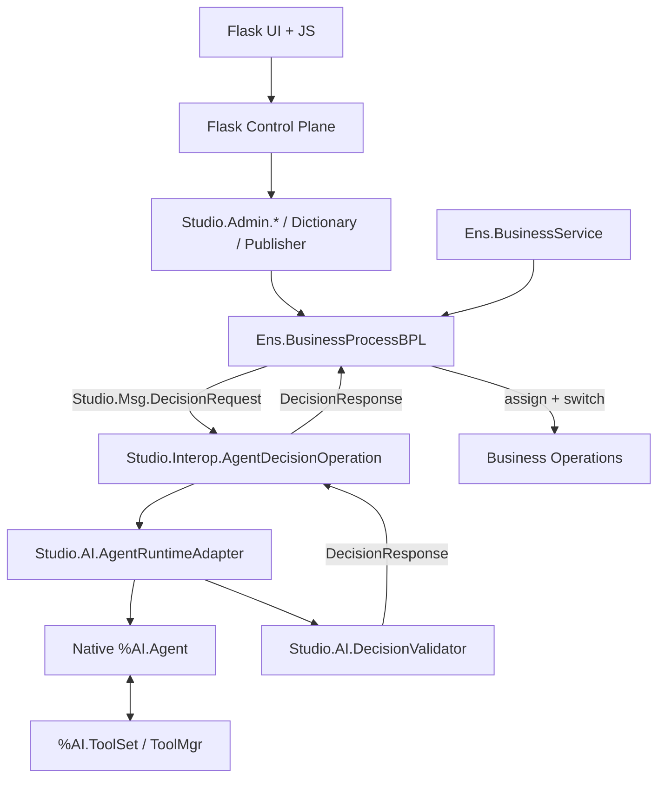

# AGENTIC BPL STUDIO — SPEC MESTRA

> **Registro de implementação:** [SPEC/IMPLEMENTATION_STATUS.md](SPEC/IMPLEMENTATION_STATUS.md).
> Build 154, authenticated WSGI, BPL releases, simulation and two LIVE decisions with READ tools validated.
> Original proposal inventories follow; see the implementation status above for current evidence.

> Evolução visual (31/10/2026): o Designer agora compõe até oito blocos de decisão gerenciados, com arrastar e soltar, Inspector lateral, revisões independentes e publicação versionada. As restrições de slot único abaixo são históricas; consulte `plano.md` e `contracts/openapi.yaml`. Operations independentes continuam disponíveis no editor BPL nativo. Testes novos LIVE ainda não executados por bloqueio de autorização.

**DOCUMENTO:** ABS-SPEC-001  
**EDIÇÃO:** MVP 1.0 — 25/10/2026  
**STATUS:** Reference specification; current implementation and validation: `SPEC/IMPLEMENTATION_STATUS.md`.
**PLATAFORMA:** InterSystems IRIS AI Hub Community EAP `2026.3.0AI.154.0`.  
**REFERÊNCIAS:** `SPEC/` (arquitetura completa), `agents/` (sete especialidades).

> **MISSÃO:** Desenvolver uma evolução **complementar** do editor visual BPL para arquitetar, configurar, testar e publicar **workflows nativos de Interoperability contendo decisões de agentes `%AI.Agent`**.
>
> **OBJETIVO NÃO É PUBLICAR AGENTES ISOLADOS.** O artefato entregue deve ser um Business Process BPL executável numa Production IRIS, com Input e Output agênticos integrados ao `request/context/response` e rotas BPL.

## 1. SITUAÇÃO E LIMITES DE COMANDO

**1.1 — Situação existente.** O editor BPL da InterSystems suporta atividades, `call`, `assign`, `switch`, transformações, variáveis, propriedades, validação e compilação. O AI Hub possui agentes, providers, sessões, ToolSets e políticas conforme a superfície do build.

**1.2 — Lacuna.** Uma chamada AI Hub precisa de composição manual: mapeamento `request/context → entrada do agente`, configuração do agente e ferramentas, validação de decisão, mapeamento para o BPL e desvio no `switch`.

**1.3 — Solução.** Um componente visual composto **AI Decision**, cujo equivalente executável usa atividades BPL nativas e um Business Host reutilizável `Studio.Interop.AgentDecisionOperation`.

**1.4 — Limites mandatórios.** O Studio NÃO DEVE alterar kernel, classes `%AI.*`, classes `Ens.*` ou editor proprietário. O Studio NÃO DEVE criar um segundo motor de workflow no Flask. BPLs arbitrários não reconhecidos DEVEM permanecer somente leitura.

## 2. QUATRO TELAS OBRIGATÓRIAS

| Código | Tela | Entrada | Operação | Saída |
|---|---|---|---|---|
| **T-01** | **Workflow Explorer** | namespace, Production e classe BPL | Descobrir processos e verificar editabilidade | Workflow selecionado / draft gerenciado |
| **T-02** | **Agentic BPL Designer** | BPL reconhecido, `DecisionBinding` | Configurar Inputs, Agent, Tools, Outputs e Runtime | Binding tipado, revisável e validado |
| **T-03** | **Workflow Test & Trace** | mensagem de teste e release | Injetar mensagem real, seguir trace, registrar decisão | Evidência de BPL → `%AI.Agent` → BPL |
| **T-04** | **Workflow Publisher** | draft validado e autorização | Diff, stage, compile, deploy controlado, release | Workflow BPL publicado ou erro explícito |

### 2.1 T-01 — Explorer

- **EX-01:** Listar somente namespaces/Productions autorizadas.
- **EX-02:** Descobrir classes BPL, Business Hosts existentes e compatibilidade para leitura/edição.
- **EX-03:** Abrir BPL gerenciado; ao detectar XML/atividades não suportadas, aplicar read-only e informar motivo.
- **EX-04:** Criar novo workflow exclusivamente a partir de template gerenciado e versionado.

### 2.2 T-02 — Designer: AI Hub Inspector (cinco abas)

| Aba | Entrada | Capacidades da interface | Verificação antes de salvar |
|---|---|---|---|
| **Inputs** | `request`, `context`, constantes | Seleção de campos via `%Dictionary`, tipagem, obrigatoriedade, preview redigido, conversão limitada | Propriedade existente; tipo compatível; campos requeridos presentes |
| **Agent** | Agente nativo `%AI.Agent` | Vincular configuração reutilizável, Provider, modelo, instruções, sessão, limites suportados | Provider e referência válidos; não presumir API do build 162 |
| **Tools** | Catálogo de `%AI.ToolSet` | Descoberta, associação, contrato de parâmetros, privilégios, distinção READ/WRITE | ToolSet instalada, acesso autorizado; leitura por padrão |
| **Outputs** | Decisão estruturada da IA | Schema, enum de ações, `callresponse → context/response`, switch BPL, fallback | Todas as ações mapeadas; erro e inválido têm fallback |
| **Runtime** | Limites e políticas | Timeout, limites de iterações, política de sessões, retries somente seguros, auditoria | Limites válidos; segurança e recuperação determinísticas |

- **ED-01:** Renderizar nós BPL nativos com fidelidade suficiente para navegar e inserir apenas no trecho gerenciado.
- **ED-02:** Associar agente a um `DecisionBinding` versionado sem modificar silenciosamente outro workflow.
- **ED-03:** `AI Decision` é abstração **da UI**, não instrução oficial BPL.
- **ED-04:** Resposta de IA é dado não confiável. A validação enum/schema/policy ocorrerá antes da rota.
- **ED-05:** Efeitos externos serão executados pelo BPL e por Operations autorizadas, nunca decididos livremente pelo modelo.

### 2.3 T-03 — Test & Trace

- **TS-01:** Gerar e enviar `Ens.Request` de teste por um Business Service da Production de demonstração.
- **TS-02:** Correlacionar `MessageId`, `CorrelationId`, `DecisionBinding`, release, sessão AI Hub e operação de destino.
- **TS-03:** Apresentar Input enviado, Tool calls observadas (somente quando instrumentadas), resposta bruta sanitizada, resposta validada e destino BPL.
- **TS-04:** Separar visualmente execução real de simulação/replay.
- **TS-05:** Cobrir respostas válidas, `INVALID`, indisponibilidade, timeout, negação de ToolSet e fallback.

### 2.4 T-04 — Publisher

- **PUB-01:** Publicar o **workflow completo**, nunca o agente como produto independente.
- **PUB-02:** Realizar validação de todas as classes, vínculos, policies, contratos e rotas.
- **PUB-03:** Obter hash/baseRevision, apresentar diff e detectar edições concorrentes do BPL.
- **PUB-04:** Gerar alteração BPL apenas para template/trecho reconhecido; compilar staged; falha = não publicado.
- **PUB-05:** Registrar release imutável, IDs de binding/agent revision e capacidade de rollback de configuração.

## 3. ARQUITETURA DE EXECUÇÃO



**Plano administrativo:** Flask recebe requisições web e invoca `Studio.Admin.*` via porta `IrisGateway`. Preferred deployment: Flask WSGI no IRIS **só após validar Web Gateway e Python no 154**.

**Plano de execução:** Business Hosts, `%AI.Agent` e ToolSets rodam no IRIS; Flask não deve participar da execução de mensagens.

**Contratos:** `Studio.Msg.DecisionRequest` e `Studio.Msg.DecisionResponse` são tipos próprios propostos. `DecisionBinding` vincula uma atividade BPL a uma configuração reutilizável de agente. `WorkflowRelease` congela versão e política.

## 4. INTERFACES PRINCIPAIS — ASSINATURAS DE PROJETO

| Camada | Contrato proposto | Efeito |
|---|---|---|
| Flask | `create_app(config: dict | None = None) -> Flask` | Inicializar aplicação WSGI |
| Python | `IrisGateway.detect_capabilities() -> dict` | Comprovar ambiente |
| Python | `IrisGateway.list_workflows(production: str) -> list[dict]` | Alimentar Explorer |
| ObjectScript | `Studio.Admin.BPLReader.ReadDefinition(...)` | Introspecção read-only do BPL |
| ObjectScript | `Studio.Admin.BindingService.SaveBinding(...)` | Salvar draft com versão |
| ObjectScript | `Studio.Admin.BPLPublisher.CompileStaged(...)` | Compilar alterações compatíveis |
| ObjectScript | `Studio.Interop.AgentDecisionOperation.HandleDecision(...)` | Tratar `DecisionRequest/Response` |
| ObjectScript | `Studio.AI.AgentRuntimeAdapter.Invoke(...)` | Chamar AI Hub build 154 após probe |
| ObjectScript | `Studio.AI.DecisionValidator.Validate(...)` | Verificar enum/schema/policy |

**ATENÇÃO:** São interfaces nossas **propostas**, não assinaturas oficiais comprovadas. Tipos completos, retornos e responsabilidades estão em `SPEC/OBJECTSCRIPT_INTERFACES.md` e `SPEC/PYTHON_INTERFACES.md`.

## 5. MAPA DE ARQUIVOS — ORDEM E RESPONSABILIDADES

```text
agentic-bpl-studio/
├── spec.md                       # ESTE DOCUMENTO — ordem mestra
├── README.md                     # uso do scaffold, estado e referências
├── agents/                       # sete especialistas de engenharia, versões mais recentes anexadas
│   ├── IA_HUB.agent.md
│   ├── iInteroperability.agent.md
│   ├── iEmbeddedPython.agent.md
│   ├── docker.iris.agent.md
│   ├── iris.Dictionary.agent.md
│   ├── iris.VectorSearch.agent.md
│   └── iris.IntegratedML-AutoML.agent.md
├── SPEC/                         # arquitetura completa, interfaces e planejamento
│   ├── SPEC_FUNCIONAL_MVP.md
│   ├── SPEC_TECNICA_IMPLEMENTACAO.md
│   ├── REPO_MAP.md
│   ├── OBJECTSCRIPT_INTERFACES.md
│   ├── PYTHON_INTERFACES.md
│   ├── SEQUENCE_FLOWS.md
│   └── VALIDACAO_BUILD_154.md
├── contracts/                    # OpenAPI e schemas JSON
├── backend/                      # scaffold Flask + WSGI, 4 telas e gateway port
├── tests/                        # testes do scaffold Flask (exigem dependências)
└── requirements.txt              # dependências web
```

Os arquivos de **classes IRIS e deploy** previstos na arquitetura (`src/iris/Studio`, `deploy/`) **ainda não existem** neste pacote. Ver mapa de arquivos previsto em `SPEC/REPO_MAP.md`.

## 6. ORDEM DE EXECUÇÃO — GATES

| Gate | Objetivo | Condição de avanço |
|---|---|---|
| **G0** | Introspecção do build 154: `%AI.*`, `Ens.*`, WSGI e runtime Python | APIs/assinaturas reais descobertas e documentadas |
| **G1** | Construir e rodar `BPL → DecisionRequest → %AI.Agent + ToolSet → DecisionResponse → BPL.switch` | Dois eventos e ações distintas, traces comprovados |
| **G2** | Configurar bindings/agents/Tools, persistir drafts versionados | Contratos e permissions validados |
| **G3** | Conectar quatro telas Flask, canvas e Publisher restrito | Processo gerenciado editável e compilável |
| **G4** | Suite de falhas, build/deploy reproduzível, documentação e demo real | GO para submissão |

**NO-GO:** integração AI Hub não demonstrada no build 154; saída LLM inválida dispara operação externa; compilação falhou mas UI declarou sucesso; publicação altera BPL não reconhecido; só existe demo simulada.

## 7. REUTILIZAÇÃO E LIMITES DO MVP

- Um `AgentDefinition` pode ser utilizado por vários `DecisionBinding`, cada um com Input/Output/route independente.
- As ToolSets são descobertas no IRIS e usadas sob permissão. Vector Search e IntegratedML podem ser oferecidos como tools **opcionais** e exigem implementação específica, não são pré-requisito para demonstrar o MVP.
- Fora do MVP: editor universal de BPL, alteração do Management Portal, subagentes experimentais não confirmados no 154, geração irrestrita de código e plugins proprietários.

## 8. FONTE DE VERDADE E DOCUMENTAÇÃO

**Requisitos funcionais:** `SPEC/SPEC_FUNCIONAL_MVP.md`  
**Arquitetura técnica:** `SPEC/SPEC_TECNICA_IMPLEMENTACAO.md`  
**Mapa completo de arquivos:** `SPEC/REPO_MAP.md`  
**Assinaturas ObjectScript:** `SPEC/OBJECTSCRIPT_INTERFACES.md`  
**Assinaturas Python:** `SPEC/PYTHON_INTERFACES.md`  
**Diagramas:** `SPEC/SEQUENCE_FLOWS.md`  
**Validação do EAP:** `SPEC/VALIDACAO_BUILD_154.md`  
**Contratos de HTTP e mensagens:** `contracts/openapi.yaml`, `contracts/schemas/`.

Fontes oficiais: [BPL](https://docs.intersystems.com/irislatest/csp/docbook/DocBook.UI.Page.cls?KEY=EBPL_intro) · [BPL Editor](https://docs.intersystems.com/irislatest/csp/docbook/DocBook.UI.Page.cls?KEY=EBPL_editorintro) · [WSGI](https://docs.intersystems.com/irislatest/csp/docbook/DocBook.UI.Page.cls?KEY=AWSGI) · [AI Hub EAP](https://github.com/intersystems-community/ai-hub-eap) · [Concurso](https://community.intersystems.com/post/intersystems-programming-contest-ai-agents-interoperability-workflows).

**VERIFICAÇÃO DE ESTADO:** conteúdo arquitetural e scaffold, **não** implementação funcional conectada ao IRIS. Ações HTTP `/api/v1/*` ainda retornam 501 por desenho. 
